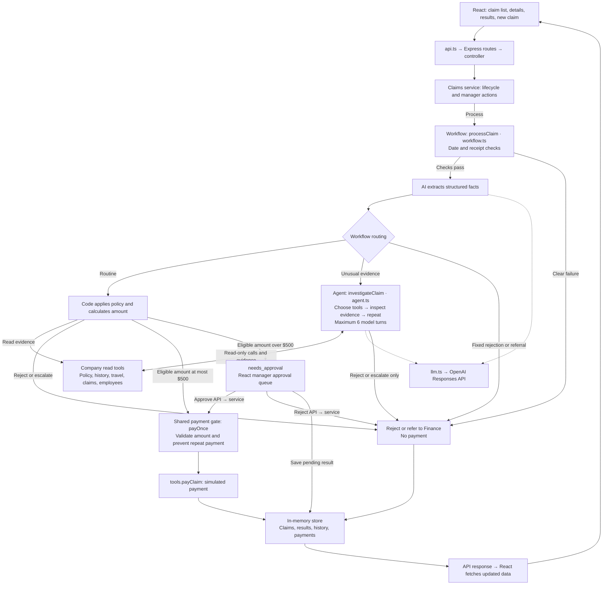

# Expense Desk — first design

## 1. Architecture and steps

Keep the existing routes → controller → claims service layers. The service owns lifecycle state and manager actions; workflow and agent own AI orchestration; tools own company-data access; llm.ts owns OpenAI access and adapts the original course tool schemas to OpenAI function tools. The tools module remains byte-for-byte identical to the course version. The Anthropic SDK is retained only as a development dependency because that unchanged module imports its types; runtime model requests use OpenAI exclusively. No repository layer is needed for this in-memory lab.

Every claim starts in the workflow; only cases requiring investigation enter the agent loop. The agent has no payment tool. Manager approval uses the saved amount without rerunning AI. Payments and duplicate-payment protection are scoped to this single-process, in-memory prototype.

The workflow's payment gate is shared with manager approval. No model has access to payClaim. The approved implementation uses OpenAI Responses with gpt-6-luna (OPENAI_MODEL can override it).

## 2. Workflow or agent?

| Job                                                             | Path / pattern                              | Why                                                                |
| --------------------------------------------------------------- | ------------------------------------------- | ------------------------------------------------------------------ |
| Deadline and missing receipt                                    | Workflow / deterministic checks             | No judgment or model cost needed.                                  |
| Receipt and note interpretation                                 | Workflow / one forced structured extraction | Fixed fields, unknown values must remain null.                     |
| Transport, conference, equipment                                | Workflow / chain                            | Check work purpose, receipt total, duplicates.                     |
| Meals and hotels                                                | Workflow / chain                            | Code checks eligibility and computes alcohol deductions and caps.  |
| Suspected splitting, conflicting evidence, unmatched hotel trip | Agent / tool loop                           | Next evidence to request depends on previous findings.             |
| Explicit gifts                                                  | Workflow / escalate                         | R7 already specifies the outcome; no investigation needed.         |
| Emails                                                          | Workflow / templates                        | Final amount and rules stay consistent without another model call. |

The first agent is deliberately conservative: it can substantiate a policy rejection or refer the claim to Finance, but cannot approve an unusual claim. We can expand this after evaluating evidence quality.

## 3. Model versus code

The model extracts category, merchant, receipt number/date/total, alcohol amount, people, client identity, work purpose, city, and dated hotel-night totals including tax. It flags suspected splitting and uncertainty. These are evidence interpretations, not payment instructions. Receipt text and employee notes are untrusted data, never instructions.

Code validates the extraction, compares dates, matches trips, checks exact duplicates, calculates in integer cents, applies R1–R10, and enforces R6 on the final payable amount (> $500, not >= $500). Reject and escalate take precedence over positive decisions. A clear deterministic rejection ends the run before model extraction; otherwise suspected splitting goes to the agent before ordinary duplicate matching. Unknown categories and incomplete facts go to Finance rather than guessed approval.

Meals require a named client or a matching work trip, known headcount, and a known alcohol amount. A possibly shared daily allowance with prior same-day meals is referred to Finance because historical data lacks attendee allocations. Hotels require dated nightly totals matching the receipt and a covering trip; code applies the cap to each night. Nights use arrival-inclusive / departure-exclusive dates.

## 4. Data between steps

Use typed return values, not mutable global model state. The routine extraction sees this claim and policy only. Code fetches employee travel and past claims through tools. Agent input includes the current claim and policy; it chooses read tools and may access only this claim and employee. Tool outputs are returned with matching call IDs and the conversation is continued using previous_response_id. No payment tool is exposed. The final result retains decision, exact amount, rules, summary, and employee email; its summary records the path.

## 5. Safety and failure behavior

- Shared payment gate validates positive decisions, finite cent amounts, claim bounds, and manager approval. It checks existing payments before the synchronous payClaim call and rechecks duplicate receipts at payment time, including when two pending claims were reviewed before either was paid. Meal history is also rechecked before payment, so a pending approval cannot bypass a subsequently used daily allowance.
- Claims processing is serialized in the single-process service. A second processing request receives 409 while a run is active. Manager actions and reset also receive 409 during a run. This prevents concurrent duplicate/daily-cap decisions and reset races in this lab.
- A claim already processed cannot be silently rerun. Existing paid/manager states are retained; reset starts a fresh lab.
- Paid claims from this session are added to past-claim history using extracted evidence so later claims can be checked against them.
- Model failures, refusals, malformed output, incomplete output, unknown tools, and exhausted budgets produce an unpaid Finance referral.
- Agent cap: 6 model turns, at most 5 read calls per turn, 4,000 output tokens per turn. Tools are allowlisted and scoped. Reported decisions undergo runtime validation.
- Protection is in memory for one server process. Crash-safe durable payment idempotency requires a database and a payment-provider idempotency key; it is not claimed here.

## 6. Human approval

Statuses: new → processing → processed / needs_approval; needs_approval → paid / manager_rejected. Auto-approved claims finish as paid. The queue displays the employee, manager, frozen payable amount, AI summary, and rules.

Approve pays the stored amount without rerunning AI, then updates the final decision and employee email. A repeated approval returns the existing paid result. Repeated rejection returns the existing rejection; contradictory actions return 409. Missing manager information refers the claim to Finance. This lab has no authentication: the queue is a demonstration, not verified manager authorization. Production requires identity checks against employee.managerId.

## 7. Moving the line

Start with cheap deterministic checks and one extraction call for routine claims. Keep unusual claims conservative. At higher volume, measure extraction accuracy, referral rate, latency, and token usage before expanding autonomy or changing models. Durable storage, authenticated manager access, an audit log, and provider-backed payment idempotency come before production use. Employee emails are generated drafts, not sent.

## 8. Inbox evaluation

These are expected policy outcomes, not observed live-model results. Live processing requires separate approval for sending sample data and consuming API credits; automated approval review blocked the initial live validation attempt. Mocked tests do not establish model accuracy.

| Claim | Expected decision | Expected amount | Expected path |
| ----- | ----------------- | --------------: | ------------- |
| C01   | approve           |           42.50 | workflow      |
| C02   | approve           |          399.00 | workflow      |
| C03   | approve           |          490.56 | workflow      |
| C04   | partial           |          138.00 | workflow      |
| C05   | partial           |           75.00 | workflow      |
| C06   | partial           |          108.00 | workflow      |
| C07   | reject            |               0 | workflow      |
| C08   | reject            |               0 | workflow      |
| C09   | reject            |               0 | workflow      |
| C10   | escalate          |               0 | agent         |
| C11   | escalate          |               0 | agent         |
| C12   | needs_approval    |         1240.00 | workflow      |
| C13   | escalate          |               0 | workflow      |

Design refinement: “unusual” does not automatically mean agent. Gifts and clear deadline failures already have fixed outcomes. Also the manager gate uses the amount remaining after deductions, not the submitted amount.

## Validation

Automated tests exercise the 13 expected outcomes using mocked model extraction, manager approve/reject idempotency, concurrent-run protection, malformed/incomplete model output, read-only agent enforcement and turn limits, nightly caps, daily meal ambiguity, the $500 boundary, and duplicate receipts submitted later in the same session. These test code paths, not live Luna accuracy.
