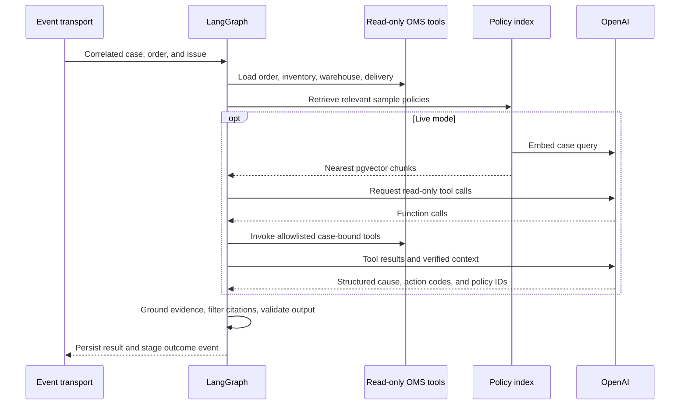

# AI investigation workflow

Sample policy documents are split into sentences, embedded with `text-embedding-3-small`, and stored as 1,536-dimensional vectors. Retrieval ranks by cosine distance. Policy text provides context for recommendations. Separate deterministic checks govern approvals and execution.

The model selects from a small case-study cause and action vocabulary. Evidence is rendered from verified tool data and policy references are intersected with retrieved records. A cause must agree with observed warehouse and carrier states. Missing evidence, unsupported actions, or a model refusal can produce a manual-review recommendation. Transport and service errors produce a failed investigation that the agent can retry.

The live integration uses strict function definitions and a strict Chat Completions response schema, then validates the result with Zod. [OpenAI function calling](https://developers.openai.com/api/docs/guides/function-calling), [OpenAI Structured Outputs](https://developers.openai.com/api/docs/guides/structured-outputs?api-mode=chat)

Drafting receives the execution summary and reference. It has no notification or modification tools. Agent confirmation is required before the resolution service calls the mock notification adapter.
