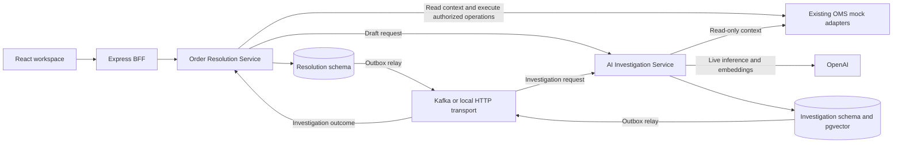
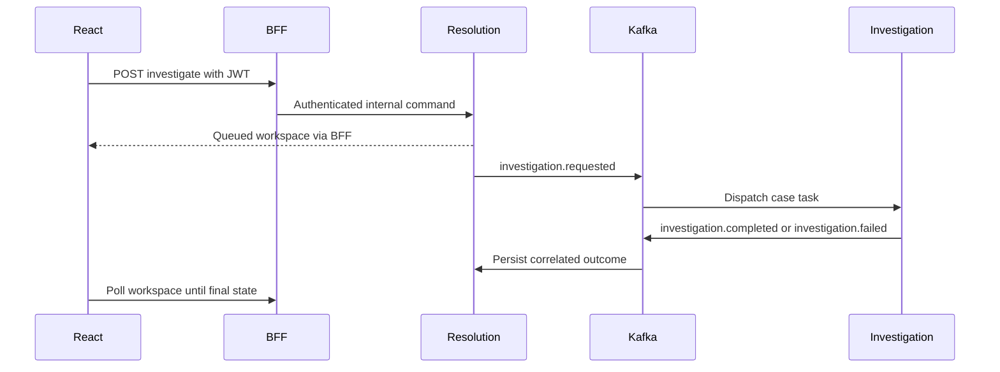

# Architecture

The resolution service owns the case workflow snapshot, approval, execution receipt, response, and timeline. One JSON aggregate keeps case transitions coherent and small for this single-case exercise. The investigation service owns outcome records and its policy index. Both store outbox events and consumer receipts in their own schemas. Services exchange data via HTTP and Kafka.

Each backend uses `app.ts`, `server.ts`, Express routers, and thin controllers. Shared server utilities supply JSON errors, internal request authentication, logging, and the file demo repository. Application services own transition rules. Prisma repositories own transactions and query construction. The BFF delegates commands and returns the aggregated workspace.

## Identity

Demo mode issues two-hour HS256 JWTs for the two seeded identities. The BFF verifies issuer, audience, signature, and role shape. It forwards the authenticated actor over an internal route secured by a shared secret. The resolution service enforces role and state on each command. Only a supervisor may decide approval. Agent-only commands cover selection, execution, response and closure.

A production OIDC integration would disable demo sign-in, validate signed access tokens against provider JWKS, check issuer, audience, expiry and tenant, and map IdP groups to roles. It would also verify case ownership and replace shared-secret forwarding with service identity and short-lived signed actor context.

## Execution boundaries

Existing OMS integrations are deterministic adapters. Rescheduling updates the visible appointment and capacity, a refund updates payment eligibility, replacement reduces sellable stock, and a goodwill credit appears on the order summary. The case’s persisted workflow ID keys the simulated receipt.

In production, separate a durable execution intent from the external call, submit the workflow ID as an idempotency key, and reconcile unknown outcomes before allowing a new action. The local transaction serializes case changes and commits the outbox with the workflow. An external OMS operation and a database transaction have separate commit boundaries.
