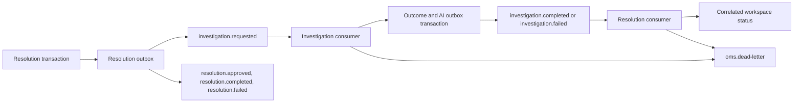

# Event flow

KafkaJS messages are keyed by case ID. The validated envelope carries a unique event ID, case ID, correlation ID, UTC timestamp, topic, and topic-specific data. Investigation events use the investigation ID for correlation. Resolution events use the workflow ID.

The relay publishes pending records and marks them after a broker acknowledgment. Crashes between publish and acknowledgment persistence can cause duplicates. The investigation repository keys outcomes by correlation ID and writes the processed receipt alongside the outbox. The resolution repository deduplicates event IDs transactionally and ignores outcomes that do not match the queued investigation.

Each service has its own consumer group. Handlers retry transient failures and publish malformed or exhausted messages to `oms.dead-letter` with their original topic and offset. KafkaJS handles broker connection retries. The outbox relay leaves failed publishes pending for a later tick. For production, monitor outbox age and dead-letter volume, and use a controlled replay tool with stable event IDs.
