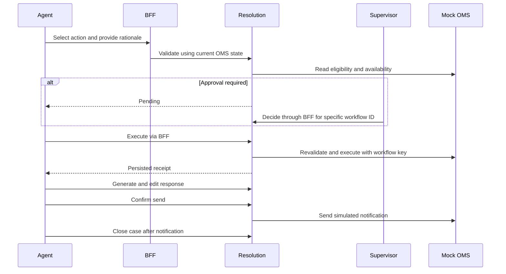

# Workspace flow

Emma Carter calls customer support about a missed delivery. Sarah Chen takes the call, logs the exception against order PB-10245, and opens EX-2048 to handle it herself. A supervisor makes approval decisions when required, and Sarah continues handling the case afterward. EX-2048 starts with a seeded intake. Select **Register call** on the queue to enter a missed delivery for demo order PB-10246. The form opens EX-2049 directly for the agent who took the call. The customer receives the reviewed response through the simulated notification service.

Use the Exceptions breadcrumb to return to the queue. The case workspace combines customer intake, order details and an illustrative product image with cross-system evidence, an investigation summary, recommended actions, and case activity.

| View | What to do |
| --- | --- |
| Exception queue | Find EX-2048 by case ID, order, issue, or customer and open it. |
| Resolution Workspace | Verify the intake and cross-system evidence, then start investigation. |
| Order Details | Review the item image, SKU, order date, original window, current delivery, and payment. |
| AI Investigation | Wait for the outcome, read the cause, evidence and policy references, and mark recommendations reviewed. A failed investigation can be retried. |
| Resolution Actions | Select a recommendation or choose another action. Provide the required window, credit amount, and notes where applicable. Validate before executing. |
| Approval | Switch to supervisor for pending decisions. A rejection returns the case to action selection. After manager review, the original agent selects a resolution and continues handling the case. |
| Customer Response | Generate a draft from the actual execution receipt. Edit the text, confirm review, send, then close. |
| Timeline | Review the chronological audit, including the roles and decisions involved. |

